# Diagrams

Every diagram of the IGNACC Controller, with two explanations: **plain words**
for anyone, and **for engineers** for the details.

All diagrams are SVG, so they render on GitHub, in VS Code's Markdown preview and
in the Doxygen HTML pages. They are generated from
[generate_diagrams.py](generate_diagrams.py), which needs only the Python
standard library. To change one, edit its function and re-run:

```bash
python docs/diagrams/generate_diagrams.py
```

| Group | Diagrams |
|---|---|
| 1. Big picture | system context · use cases · layered architecture · component dependencies |
| 2. Behaviour | 3 state machines · 2 activity diagrams |
| 3. Interactions | 2 sequence diagrams · communication diagram · interaction overview |
| 4. Modules | protocol · relay · uart_link · app_fsm · main · Kconfig channel model · Python tester |

### Which UML diagrams, and why

| UML diagram | Used? | Why |
|---|---|---|
| Use case | Yes | The easiest way to show a non-engineer who uses the system and for what |
| Component / layered | Yes | Shows the structure: who depends on whom, and which layer does what |
| State machine | Yes | The firmware is a state machine; relays and the line assembler have states too |
| Activity | Yes | Command handling and boot are step-by-step flows with decisions |
| Sequence | Yes | Shows the timing of one command and of a whole CAPL session |
| Communication | Yes | Same messages as the sequence diagram, but highlights who talks to whom |
| Interaction overview | Yes | Ties the smaller interactions into a complete test session |
| Class | As module diagrams | The firmware is C, so "classes" are modules, structs and interfaces |
| Deployment | As the system context | Shows the physical setup: PC, USB, ESP32, relays, ECU, CAN |
| Object, package, timing, composite structure | No | They would repeat what the diagrams above already show |

---

## 1. Big picture

### System context

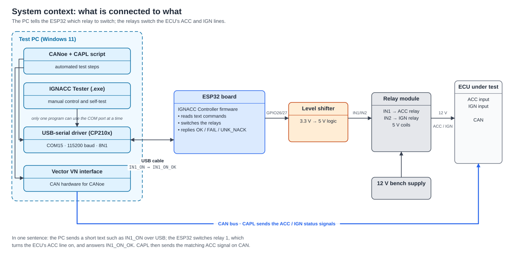

**Plain words:** the PC sends a short text such as `IN1_ON` over a USB cable. The
ESP32 switches relay 1, which turns the ECU's ACC line on, and answers `IN1_ON_OK`.
CANoe then sends the matching ACC signal on the CAN bus.

**For engineers:**
- **Link:** UART0 through the CP210x bridge at 115200 8N1.
- **Pins:** GPIO26/27 (3.3 V) go through a level shifter to the 5 V relay inputs.
- **Contacts:** the relay contacts switch the 12 V ACC/IGN lines.
- **One user at a time:** only one program can hold the COM port, either CANoe or the tester.

### Use cases

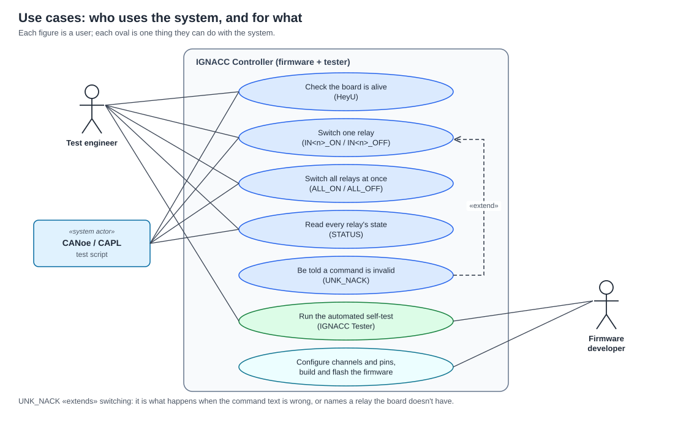

**Plain words:** three kinds of users. A test engineer clicks buttons in the
tester. A CANoe script sends commands automatically. A developer changes the
configuration and loads new firmware. Each oval is one thing they can do.

**For engineers:** `UNK_NACK` is modelled as an «extend» of switching: it is the
outcome when the command text is invalid, or names a channel the board
doesn't have.

### Layered architecture (AUTOSAR-style)

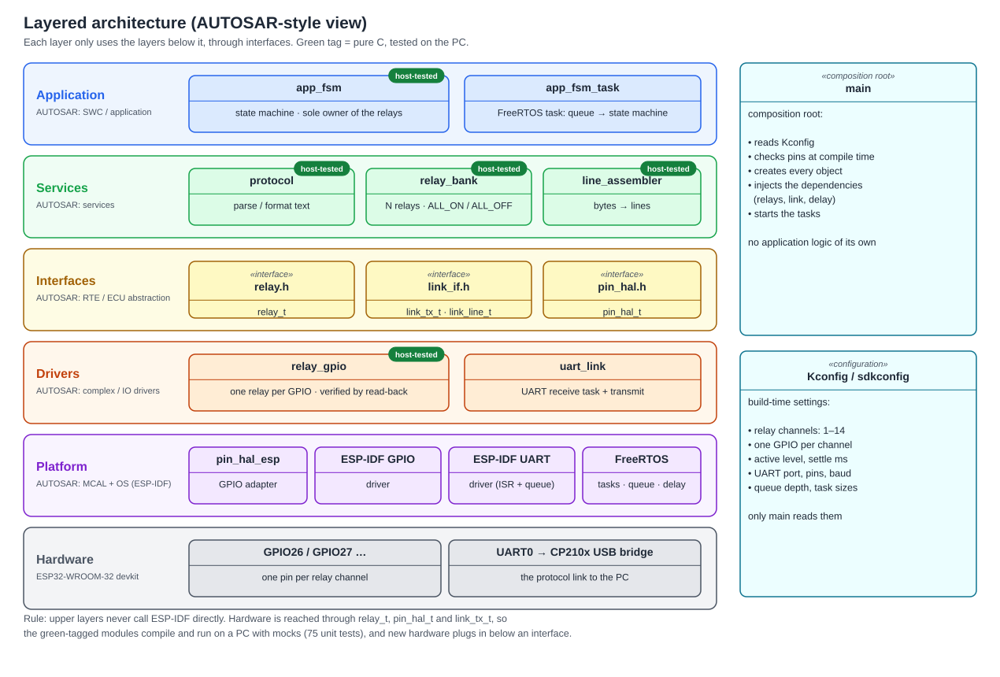

**Plain words:** the software is built in layers, like a building. Each floor
only uses the floor below it. Swapping the bottom floors (the hardware) doesn't
disturb the top floors (the logic).

**For engineers:**

| Layer | Modules | AUTOSAR analogue |
|---|---|---|
| Application | `app_fsm`, `app_fsm_task` | SWC |
| Services | `protocol`, `relay_bank`, `line_assembler` | services |
| Interfaces | `relay.h`, `link_if.h`, `pin_hal.h` | RTE / ECU abstraction |
| Drivers | `relay_gpio`, `uart_link` | IO / complex drivers |
| Platform | ESP-IDF drivers and FreeRTOS | MCAL + OS |

- **Composition:** `main` is the composition root, and the only module that reads Kconfig.
- **Green "host-tested" tags:** pure C, covered by the 75 unit tests on the PC.

### Component dependencies

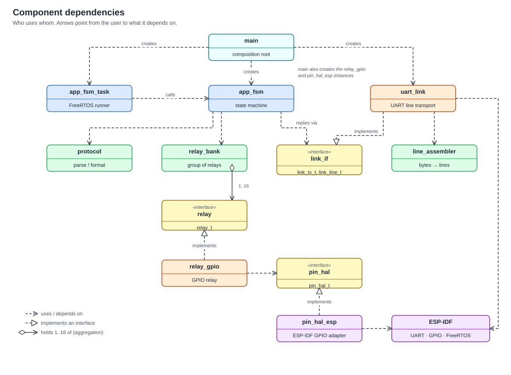

**Plain words:** who uses whom. Arrows point from the user to what it needs.

**For engineers:**
- Dashed arrows with an open head mean *uses*; a hollow triangle means *implements an interface*.
- `relay_bank` holds 1–16 `relay_t` (aggregation).
- No arrow points upward. That is what makes the core independent of the hardware.

---

## 2. Behaviour

### State machine: app_fsm

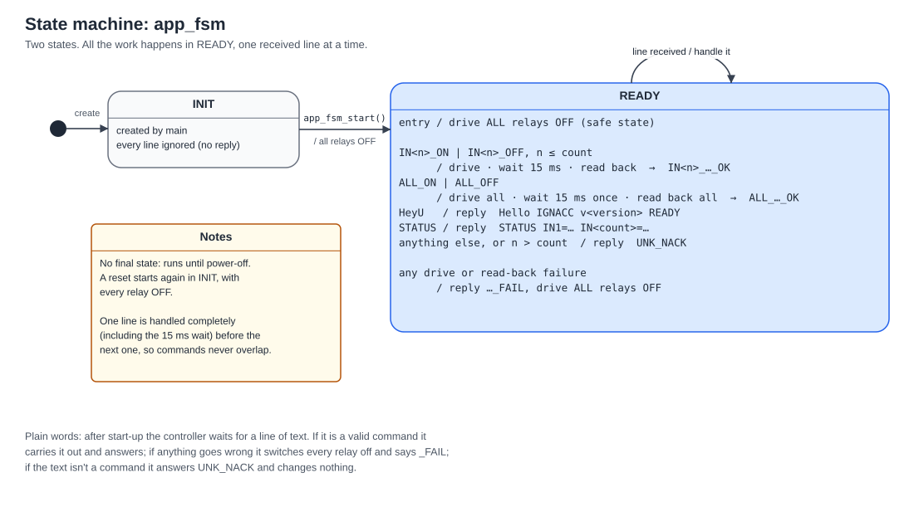

**Plain words:** after start-up the controller waits for a line of text.
- A valid command is carried out and answered.
- If anything goes wrong, it switches every relay off and says `_FAIL`.
- If the text isn't a command, it answers `UNK_NACK` and changes nothing.

**For engineers:**
- **States:** INIT, then READY via `app_fsm_start()`, which drives all relays OFF on entry.
- **Commands:** every command is an internal transition of READY.
- **No final state:** a reset re-enters INIT.
- **No overlap:** lines are handled strictly one at a time, including the settle delay.

### State machine: one relay channel

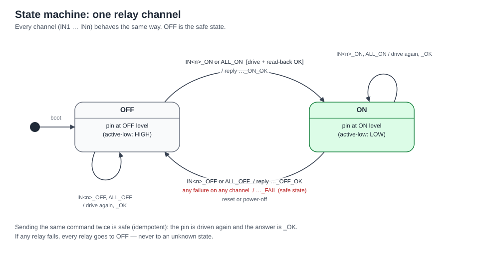

**Plain words:** each relay is either OFF or ON. OFF is the safe state. Any
failure, a reset or power-off brings it back to OFF.

**For engineers:**
- **Idempotent:** a repeated command drives the pin again and answers `_OK`.
- **Guard on OFF → ON:** the drive and the read-back must both succeed.

### State machine: line_assembler

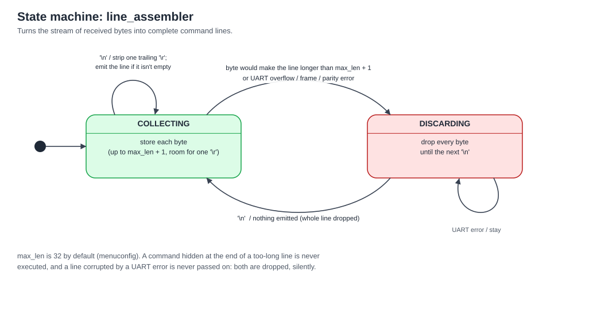

**Plain words:** the controller collects characters until it sees the end of a
line. If a line is too long, or the cable glitched, it throws the whole line
away instead of guessing.

**For engineers:**
- **States:** COLLECTING and DISCARDING.
- **Line length:** `max_len` is 32 by default. One trailing `\r` is allowed and stripped.
- **No partial commands:** an overlong line, including a command at its tail, is never emitted. Lines with UART errors are dropped too.

### Activity: handling one command

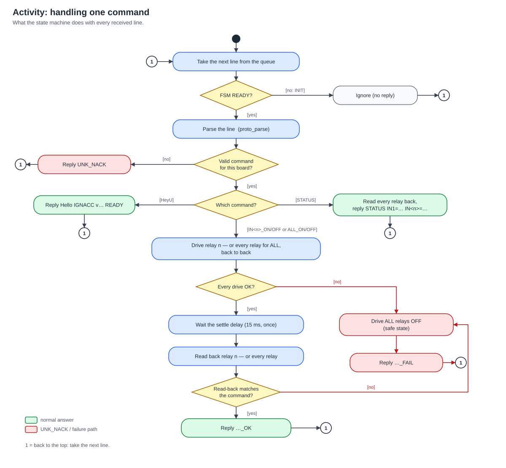

**Plain words:** the step-by-step recipe for every line of text, including what
happens on each kind of mistake.

**For engineers:**
- **Relay commands:** drive, wait the settle delay once, verify the read-back, then reply `_OK`.
- **Failure path (red):** drive all relays OFF, then reply `_FAIL`.
- **No change:** `UNK_NACK` and `STATUS` never change a relay.

### Activity: power-on to READY

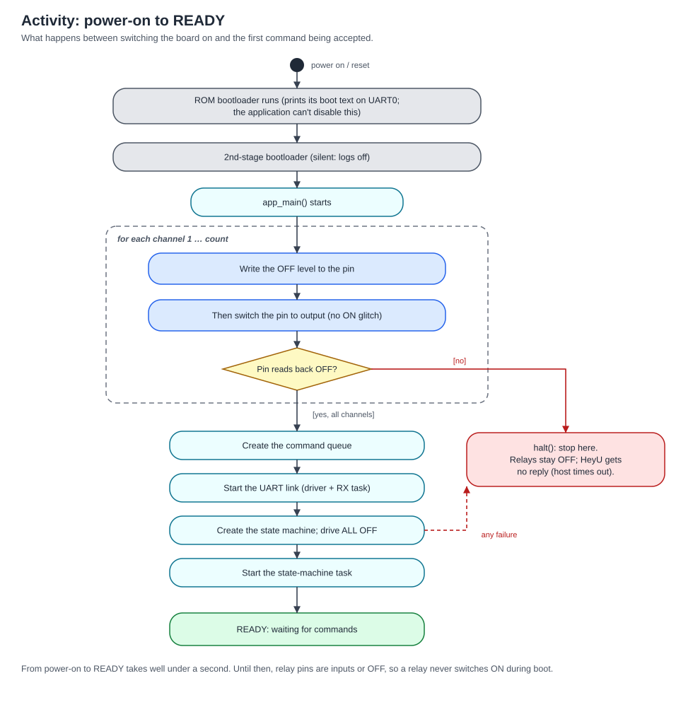

**Plain words:** what happens in the first fraction of a second after switching
on. Relays can never click ON during this time.

**For engineers:**
- **No glitch:** each pin gets its OFF level written before it becomes an output, then it is verified.
- **On failure:** any start-up failure calls `halt()`. The relays stay OFF and `HeyU` gets no reply.

---

## 3. Interactions

### Sequence: one command through every layer

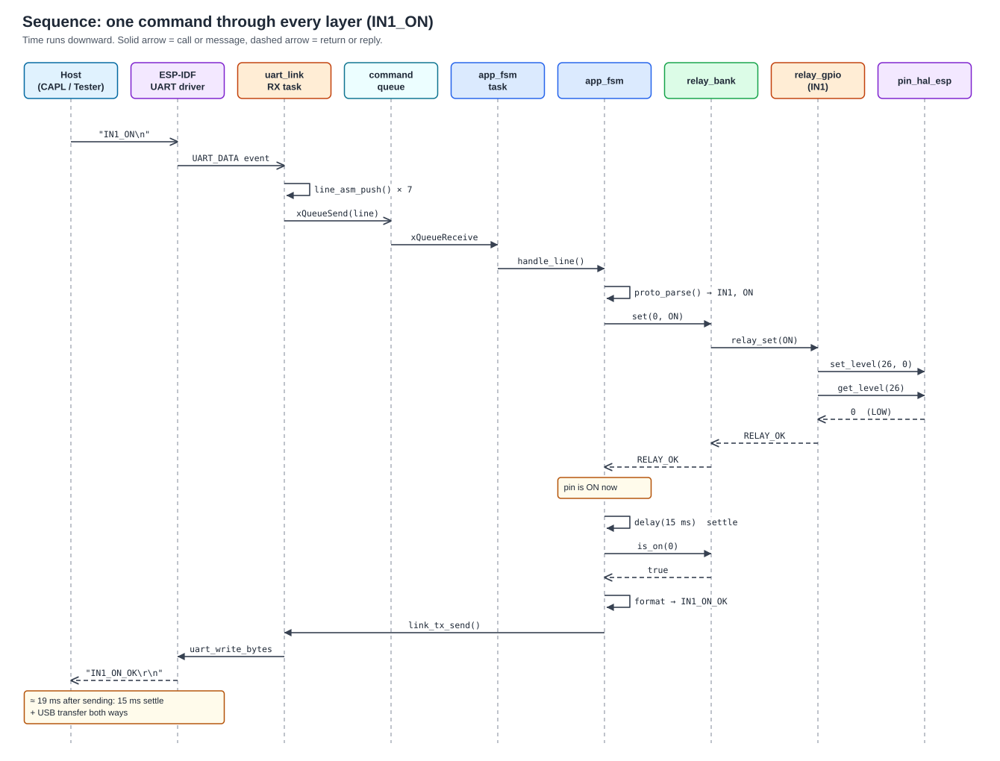

**Plain words:** what happens inside the board, from the moment `IN1_ON` arrives
until `IN1_ON_OK` goes back. Time runs downward.

**For engineers:** the full path:

1. The UART driver raises `UART_DATA`.
2. `line_assembler` turns the bytes into a line.
3. The queue hands the line to the FSM task.
4. `app_fsm`, `relay_bank`, `relay_gpio` and `pin_hal_esp` switch the pin.
5. The FSM waits the 15 ms settle delay and verifies the read-back.
6. `link_tx_send` sends the reply.

The round trip is about 19 ms.

### Sequence: a CAPL test session

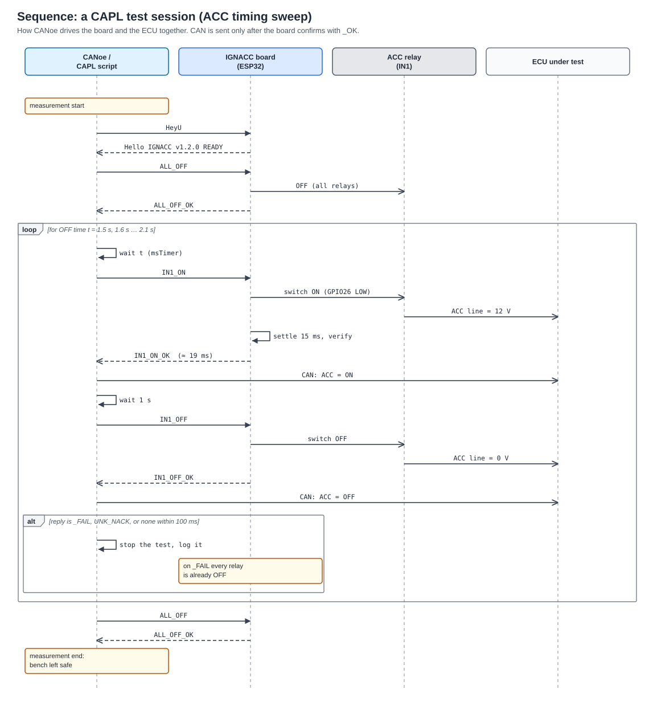

**Plain words:** how CANoe and the board work together to repeat a timing test:
switch the ACC line, wait for OK, send the matching CAN signal, and repeat with
a different delay.

**For engineers:**
- **Start:** `HeyU`, then `ALL_OFF` puts the bench in a safe state.
- **Loop:** sweeps the OFF time from 1.5 s to 2.1 s.
- **CAN after OK:** the CAN signal is sent only after `_OK`.
- **Error handling:** an alt fragment stops the test on `_FAIL`, `UNK_NACK` or a 100 ms timeout.

### Communication diagram

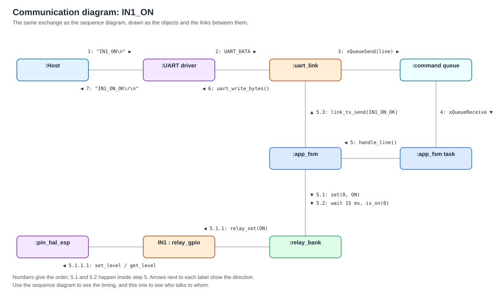

**Plain words:** the same `IN1_ON` story as the sequence diagram, drawn as a map
of who talks to whom.

**For engineers:** numbers give the order, and nested numbers (5.1, 5.1.1)
happen inside the call they extend.

### Interaction overview

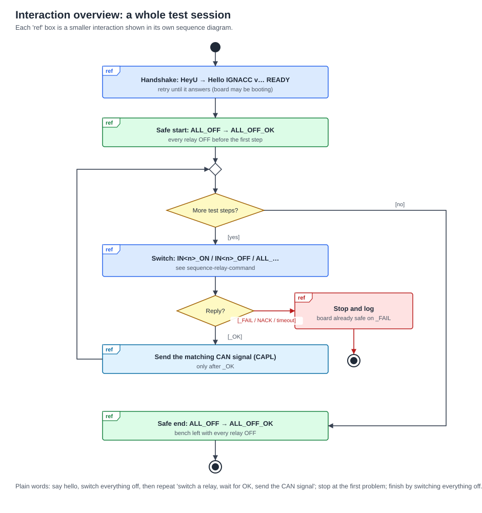

**Plain words:** say hello, switch everything off, then repeat "switch, wait for
OK, send the CAN signal". Stop at the first problem, and finish by switching
everything off.

**For engineers:** each `ref` box points to a sequence diagram. The flow merges
back before the "more steps?" decision.

---

## 4. One diagram per module

| Module | Diagram | Source |
|---|---|---|
| protocol | [module-protocol.svg](module-protocol.svg) | `components/protocol/` |
| relay (relay_t, relay_gpio, pin_hal, relay_bank) | [module-relay.svg](module-relay.svg) | `components/relay/` |
| uart_link (+ line_assembler, link_if) | [module-uart-link.svg](module-uart-link.svg) | `components/uart_link/`, `components/link_if/` |
| app_fsm (+ app_fsm_task) | [module-app-fsm.svg](module-app-fsm.svg) | `components/app_fsm/` |
| main (composition root) | [module-main.svg](module-main.svg) | `main/` |
| Kconfig channel model | [kconfig-channel-model.svg](kconfig-channel-model.svg) | `main/Kconfig.projbuild`, `main/main.c` |
| IGNACC Tester (Python) | [module-tester.svg](module-tester.svg) | `tools/ignacc_tester/` |

### protocol

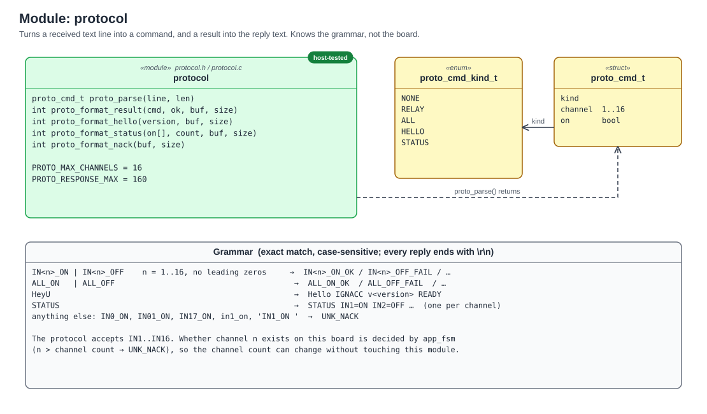

**Plain words:** the translator. It reads a line of text and works out which
command it is, then writes the answer text.

**For engineers:**
- **API:** `proto_parse()` returns a `proto_cmd_t`, and the `proto_format_*()` functions build the replies.
- **Grammar only:** the module knows the grammar (`IN1`–`IN16`), not the board. `app_fsm` decides whether a channel exists.

### relay

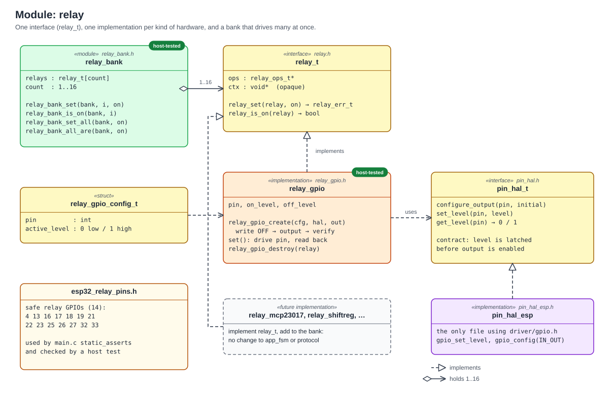

**Plain words:** one "remote control" shape (`relay_t`) that every kind of relay
hardware fits into, plus a "group" that switches many relays at once.

**For engineers:**
- **Today:** `relay_gpio` implements `relay_t` on top of `pin_hal_t`, and `pin_hal_esp` is the only file that touches the ESP-IDF GPIO driver.
- **Later:** an I/O expander or shift register is one new `relay_t` implementation. Nothing above it changes.

### uart_link

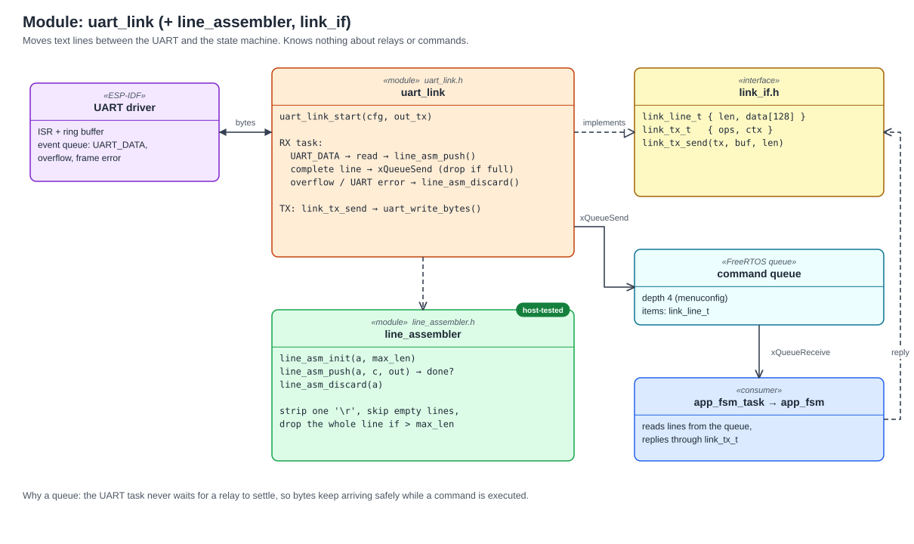

**Plain words:** the post office. It collects incoming text into complete lines,
queues them, and sends the answers back. It never looks inside the letters.

**For engineers:**
- **RX:** an RX task turns IDF driver events into `line_asm_push()` calls, then `xQueueSend()`.
- **TX:** goes through `link_tx_t`.
- **Why a queue:** the UART never waits while a relay settles.

### app_fsm

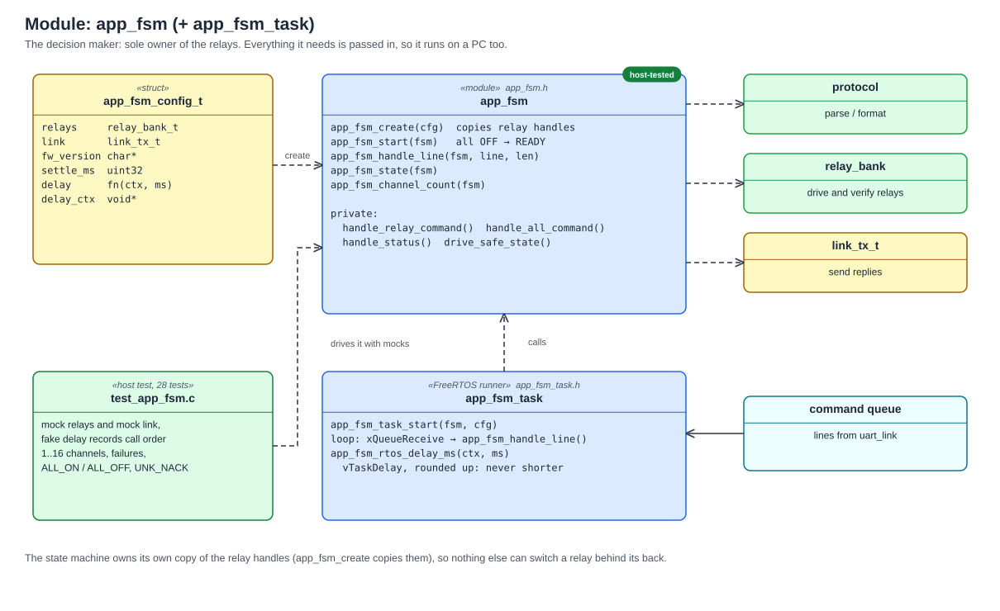

**Plain words:** the decision maker, and the only part allowed to switch relays.

**For engineers:**
- **Injected dependencies:** relays, link, delay function and version all come in through `app_fsm_config_t`. The FSM copies the relay handles, so it is their sole owner.
- **Runner:** `app_fsm_task` is the FreeRTOS loop around it.
- **Tests:** 28 host tests use mocks.

### main and the Kconfig channel model

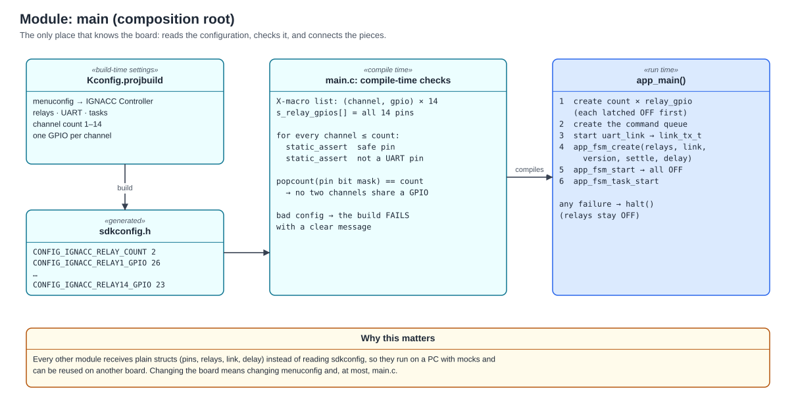

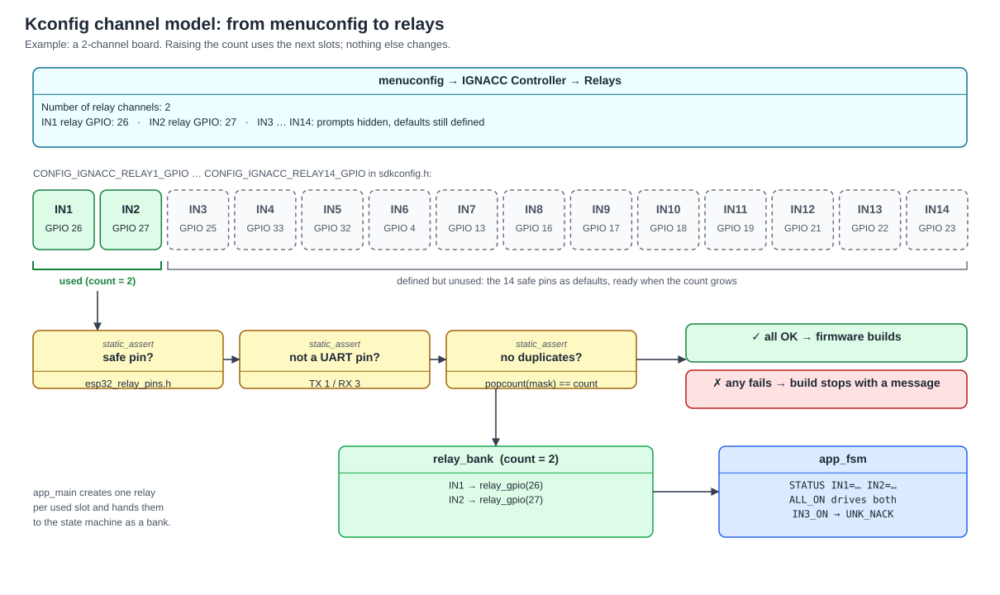

**Plain words:** the board's settings are chosen in a menu before building.
Unused relay slots are already filled with safe pins. A wrong setting stops the
build instead of reaching the bench.

**For engineers:**
- **Pin list:** an X-macro over 14 `CONFIG_IGNACC_RELAYn_GPIO` symbols. Hidden prompts still keep their defaults.
- **Checks:** `static_assert`s require a safe pin and no UART overlap, and a `popcount` check rejects duplicate pins.
- **Wiring:** `app_main` creates and wires everything. Details are in [../configuration-and-architecture.md](../configuration-and-architecture.md).

### IGNACC Tester (Python)

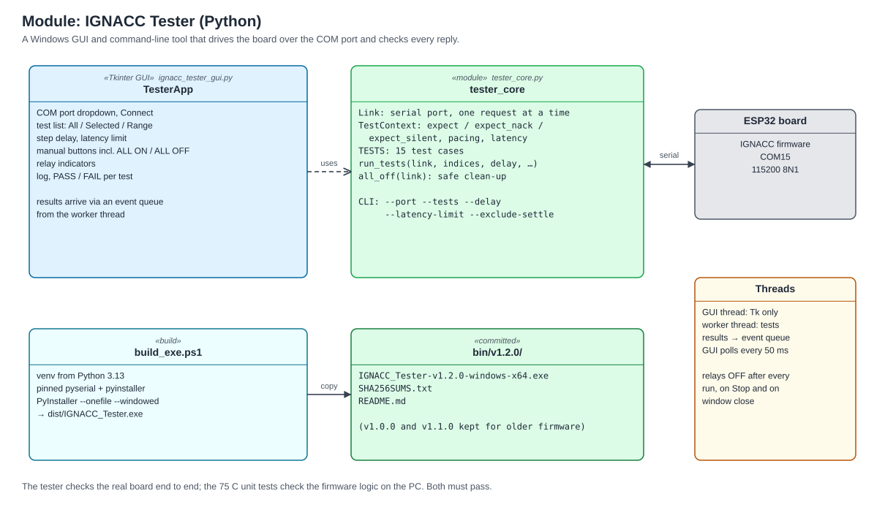

**Plain words:** the Windows app that checks the real board from the PC.

**For engineers:**
- **GUI:** `TesterApp` runs on the Tk thread, and a worker thread runs `tester_core.run_tests()`.
- **Tests:** 15 tests and 98 steps, including the `UNK_NACK` checks.
- **Build:** `build_exe.ps1` builds the single-file `.exe` committed under `bin/v<version>/`.
